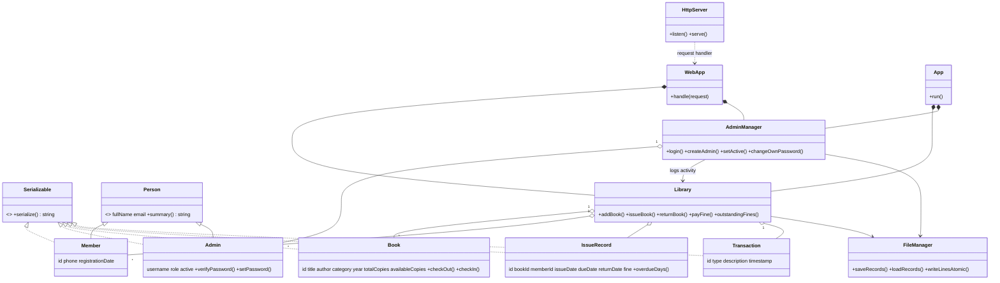

# Architecture

## Layers

```
 Browser ──HTTP──▶ src/web  (HttpServer → WebApp → Html)  ─┐
                                                            ├──▶ src/core  (Library, AdminManager, entities)
 Terminal ─────▶ src/console (App, Console, ReportManager) ─┘          │
                                                                       ▼
                                                         FileManager ──▶ Data/*.txt
```

- **`src/core`** contains every business rule (validation, fines, permissions, persistence). It never
  prints and never produces HTML, so both interfaces behave identically and the rules are tested once.
- **`src/console`** and **`src/web`** only translate user input into calls on the core and show results.

## Class diagram



## Modules

| File(s) | Responsibility |
|---|---|
| `Library` | Books, members, issues, fines, settings, transaction log; every change is validated, saved, and rolled back in memory if saving fails |
| `AdminManager` | Login, sessions, roles. Enforces: only Super Admin manages admins; no self-deactivation; the last active Super Admin cannot be deactivated |
| `Book`, `Member`, `IssueRecord`, `Transaction`, `Admin` | Entities with private state, validation and `serialize()` / `parse()` |
| `FileManager` | Creates `Data/` with `std::filesystem`, reads lines, writes via a temp file, backs up corrupt files, encodes records |
| `Security` | SHA-256, HMAC, PBKDF2, random tokens |
| `Date` | Calendar arithmetic (days since 1970-01-01) – no string comparison of dates |
| `Utils` | Trimming, formatting, validators (ID, name, email, phone, username, password) |
| `Result` | Small `{ok, message}` type returned by operations that can fail |
| `HttpServer` | Sockets (Winsock / POSIX), request parsing, response writing, security headers |
| `WebApp`, `WebCatalog` | Routing, sessions, CSRF, and all pages |
| `Html` | Escaping, tables, form fields, page layout |
| `App`, `Console`, `ReportManager` | Console menus, prompts, and text tables |

## Web request flow

1. `HttpServer` reads the request, parses it into `HttpRequest`, calls `WebApp::handle`.
2. `handle` serves the stylesheet, enforces first-time setup, login, session lookup, `Origin` and
   CSRF checks, and the Super Admin check for `/admin*`.
3. `AdminManager::resumeSession` makes the session's user the current user (so the activity log
   records the right name). The server is single-threaded, so this is safe.
4. The route handler calls the core, then either renders a page or redirects with a flash message
   (post/redirect/get).

## Data safety

- Every save writes `<file>.tmp` and then replaces the real file (with a `.bak` fallback).
- Malformed or duplicate records are skipped on load, a warning is shown, and the original file is
  copied to `<file>.corrupt-<date>.bak` before it can be rewritten.
- If the issue list and a book's copy counts disagree after a crash, the issues win and counts are repaired.
